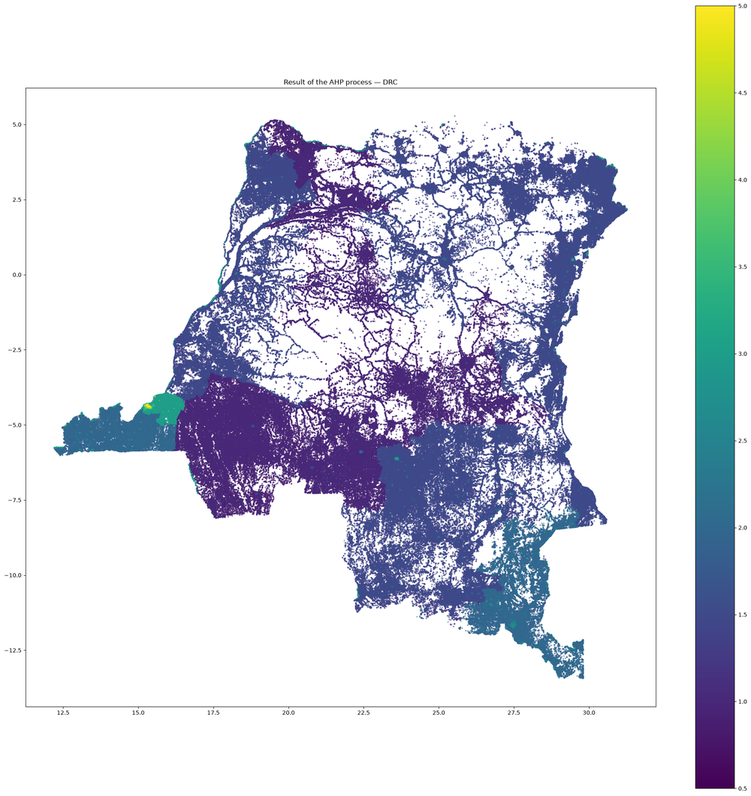

# CREDIT Model — residential electricity demand targets for any country

**CREDIT** (Custom Residential Electricity Demand Indicative Target) is a spatially explicit way of assigning residential electricity demand targets to un-electrified settlements. It combines **poverty** and **GDP** maps instead of the usual urban/rural tier split. The method is described in [Korkovelos et al. (2019), *Energies* 12(7):1395](https://www.mdpi.com/1996-1073/12/7/1395).

This repository is an updated version of the [Global Electrification Platform CREDIT_layer](https://github.com/global-electrification-platform/CREDIT_layer). It runs for **any country**: set the country in one *Settings* cell and the notebook downloads the poverty, boundary and GDP data itself (2024 data by default). The **Democratic Republic of the Congo (DRC, ISO3: COD)** is used as the worked example below.

---

## Example results: DRC

The model produces a ~1 km grid of residential demand targets for the whole country. The maps and figures below are for the DRC.

| Step 3 — Combined poverty/GDP index (1–5) | Step 4 — CREDIT demand target (kWh/capita/year) |
|:---:|:---:|
|  |  |

- **Highest targets** are around **Kinshasa**: ~300 kWh/capita/year on average, up to ~590 kWh/capita/year (MTF Tier 5) in the city centre.
- **Mid-range targets** (~150–300 kWh/capita/year) appear in Kongo Central and the south-eastern mining belt (Haut-Katanga). Both provinces average ~140–146 kWh/capita/year.
- **The east** (Ituri, Nord-Kivu, Sud-Kivu, Haut-Uele and Bas-Uele) sits at ~65–80 kWh/capita/year.
- **Lowest targets** (below ~10 kWh/capita/year) are in the poorest provinces: Kwilu, Kwango, Kasaï, Kasaï-Central, Sankuru, Maniema, Mongala, Tshuapa and Nord-Ubangi.
- About **87 %** of populated pixels are below 153 kWh/capita/year (MTF Tier 1–2). The national mean is ~66 kWh/capita/year.

> These results use the PCode join between the poverty table and the HDX boundaries. Earlier versions had no poverty data for Haut-Uele, Bas-Uele, Nord-Kivu, Sud-Kivu and Kasaï-Central (English and French province names did not match). Those provinces were treated as the least poor, which put their targets at ~140–150 kWh/capita/year.

Output files (written to `sample_output/<ISO3>/`, e.g. `sample_output/COD/`, not tracked in git; each country gets its own folder, so running another country does not overwrite these):

| File | Description |
|---|---|
| `CREDIT.tif` | Final CREDIT layer, kWh/capita/year, 1 km, in the country's UTM zone (EPSG:32734 for DRC) |
| `AHP_option_1.tif` / `clipped_sum_.tif` | Combined 1–5 index (raster option), clipped to the country |

---

## How to use this repository

### 1. Clone the repository

```bash
git clone https://github.com/Bachirou06/CREDIT_Model.git
cd CREDIT_Model
```

### 2. Create the Python environment

With conda (recommended, because GDAL and rasterio install more easily from conda-forge):

```bash
conda env create -f credit_env.yml
conda activate credit_env
```

`requirements.txt` lists the exact package versions the model was run with (Python 3.12). Use it with pip only if GDAL is already installed on your system.

### 3. Run the main notebook

```bash
jupyter lab CREDIT_layer.ipynb
```

Run the cells from top to bottom. The notebook downloads its own input data the first time:

| Input | Source | Downloaded to |
|---|---|---|
| Poverty (MPI headcount ratio, ADM1; 26 provinces for DRC) | OPHI MPI via [HDX](https://data.humdata.org/) | `poverty_data/tabular/` |
| Admin boundaries (ADM1) | [HDX COD-AB](https://data.humdata.org/dataset/?q=cod-ab) (same PCodes as the poverty table); [geoBoundaries](https://www.geoboundaries.org/) as fallback | `admin/` |
| GDP PPP (2024 by default), 30 arc-sec (~1.4 GB global file) | [Kummu et al. v4](https://zenodo.org/records/18429133) | `GDP_data/` |

Files that already exist are not downloaded again. The full run takes a while the first time, mainly because of the GDP download.

**GDP download.** The Kummu v4 data is only published as one global file (1.4 GB), and Zenodo does not allow downloading part of a file, so it has to be downloaded once. After that, only the country's clipped raster is needed (`GDP_data/GDP_<year>_<iso3>_clipped.tif`, ~20 MB for DRC): if it exists, the notebook reuses it and does not need the global file at all. Set `KEEP_GLOBAL_GDP = False` to delete the global file automatically after clipping.

### 4. Run it for another country

All country-specific values are in the **Settings** cell at the top of the notebook:

| Setting | DRC value | What to change |
|---|---|---|
| `COUNTRY_ISO3`, `COUNTRY_NAME`, `COUNTRY_LABEL` | `COD`, `Congo, Democratic Republic of the`, `DRC` | The country to model |
| `YEAR` | `2024` | GDP year (Kummu v4: 1990, 1995, …, 2020, 2024) |
| `KEEP_GLOBAL_GDP` | `True` | `False` deletes the 1.4 GB global GDP raster once the country is clipped (it is downloaded again if you run another country or year) |
| `ADMIN_SOURCE` | `auto` | `auto` = HDX COD-AB boundaries, geoBoundaries if the country has none; or force `hdx` / `geoboundaries` |
| `POVERTY_CODE_COL`, `POVERTY_NAME_COL`, `POVERTY_VALUE_COL` | `Admin 1 PCode`, `Admin 1 Name`, `Headcount Ratio` | Column names of the HDX/OPHI poverty table |
| `NAME_ALIASES` | `{}` | Optional manual matches `{boundary name: poverty-table name}` |
| `PROJECTED_CRS` | `None` (auto → EPSG:32734) | Leave `None` for the country's UTM zone, or set an EPSG code |
| `WEIGHT_POV`, `WEIGHT_GDP` | `0.5`, `0.5` | Layer weights (sum = 1) |
| `RANDOM_SEED` | `0` | Makes the GDP natural-breaks classes identical from run to run |
| `MTF_KWH_PER_CAPITA` | `[1, 7.6, 153.3, 299.0, 444.7, 590.4]` | Demand targets for index 0–5, adjusted to the country's household size |

**How poverty is joined to the boundaries.** Each admin unit is matched to the poverty table in this order: (1) by **PCode**, when the official HDX COD-AB boundaries are available, (2) by `NAME_ALIASES`, (3) by name, ignoring accents, case and hyphens, (4) by the closest similar name (fuzzy). Step 1.1.a prints how each unit was matched, lists fuzzy matches to check, and warns about any unit left without poverty data.

Step 3 keeps both ways of combining the layers: **Option 1** works directly on raster arrays (`AHP_option_1.tif`, `clipped_sum_.tif`), and **Option 2** works on points / CSV and produces the final `CREDIT.tif`.

### Folder structure

The repository holds only the code. The data and result folders are created by the notebook on the first run and are not tracked in git. Files that belong to a country carry its ISO3 code or label (`COD`/`cod`/`DRC` below), so several countries can live side by side.

```
CREDIT_Model/
│
├── CREDIT_layer.ipynb        Main workflow: settings → data → reclassification → index → CREDIT layer
├── credit_utils.py           All helper functions (data downloads, raster processing, Step 3 options, CREDIT)
├── README.md
├── LICENSE
├── credit_env.yml            Conda environment (recommended)
├── requirements.txt          Exact package versions of the tested run (Python 3.12)
├── images/                   Result maps shown in this README
│
│   ── created by the notebook (not in git) ──────────────────────────────
│
├── admin/                    Admin boundaries
│   ├── COD_cod_admin_boundaries.shp.zip     HDX COD-AB download (all admin levels)
│   ├── COD_cod_admin_boundaries/            unzipped; cod_admin1.shp is used
│   └── COD_geoBoundaries_ADM1.shp           only if the geoBoundaries fallback was used
│
├── poverty_data/
│   ├── tabular/              OPHI MPI table from HDX + cleaned copy (cod_poverty_data.csv)
│   ├── shapefile/            Poverty joined to the admin units (DRC_admin1.shp)
│   └── raster/               Rasterised poverty map (DRC_poverty_map.tif, ..._in_CRS.tif)
│
├── GDP_data/
│   ├── rast_gdpTot_1990_2024_30arcsec.tif   Global Kummu v4 raster (1.4 GB; optional after clipping)
│   └── GDP_2024_cod_clipped.tif             Country GDP for the chosen year (~20 MB)
│
├── tmp/
│   └── COD/                  Intermediate files: pixel points, classified rasters, Option 2 CSVs
│
└── sample_output/
    └── COD/                  Results for one country
        ├── CREDIT.tif                      Final CREDIT layer (kWh/capita/year)
        ├── AHP_option_1.tif                Combined index, Step 3 Option 1
        ├── clipped_sum_.tif                Option 1 index clipped to the country
        ├── AHP_result_option2.png          Map of the Option 2 index
        └── Sample_result.png               Map of the CREDIT layer
```

Running another country adds its own files next to these (for example `admin/NER_...`, `GDP_data/GDP_2024_ner_clipped.tif`, `tmp/NER/`, `sample_output/NER/`) without touching the DRC ones.

---

## Method

**Step 1 — Collect data.** ADM1-level poverty (MPI headcount ratio) is joined to the ADM1 boundaries and rasterised at 1 km. GDP PPP for the chosen year is clipped to the country.

**Step 2 — Reclassify both layers to a 1–5 scale.**

| Poverty headcount | Class | GDP (natural breaks, k = 5) | Class |
|---|:---:|---|:---:|
| < 20 % | 5 | I1 ≤ GDP < I2 | 1 |
| 20–40 % | 4 | I2 ≤ GDP < I3 | 2 |
| 40–60 % | 3 | I3 ≤ GDP < I4 | 3 |
| 60–80 % | 2 | I4 ≤ GDP < I5 | 4 |
| ≥ 80 % | 1 | GDP ≥ I5 | 5 |

The choice of classification method affects the result, so check that it suits your use case.

**Step 3 — Combine the layers** into an index from 1 (low demand) to 5 (high demand):

```
index = 0.5 × poverty_class + 0.5 × GDP_class
```

**Step 4 — Convert the index to a demand target** by linear interpolation between MTF-based minimum and maximum values, scaled for the country's average household size.

### Example settings: DRC

| Parameter | Value |
|---|---|
| Country / ISO3 | Democratic Republic of the Congo / COD |
| Poverty data | OPHI MPI headcount ratio, ADM1 (26 provinces; MPI is only published at ADM1) |
| GDP data | Kummu et al. v4, GDP PPP 2024, 30 arc-sec |
| Projection | WGS 84 / UTM zone 34S (EPSG:32734) |
| Weights | poverty 0.5, GDP 0.5 |
| Household size | ~5.3 people |
| Demand range | 7.6 kWh/capita/year (Tier 1) to 590.4 kWh/capita/year (Tier 5) |

---

> **Note.** CREDIT does not *predict* electricity demand; it is not a regression model. It is an improved way to distribute tier-based demand targets in space using available geospatial data. The MTF demand values are scaled estimates and should be checked against national calibration data for each country before they are used for planning.

## Credits and license

- **Original method and code:** [Alexandros Korkovelos](https://github.com/akorkovelos), [Global Electrification Platform](https://github.com/global-electrification-platform/CREDIT_layer)
- **Updates, modifications and adaptation to any country (DRC example):** [DJIBO BOUBE Bachirou](https://github.com/Bachirou06)
- **Data:** OPHI (MPI), HDX COD-AB, geoBoundaries, Kummu et al. (2025) GDP v4

Released under the [MIT License](LICENSE).
